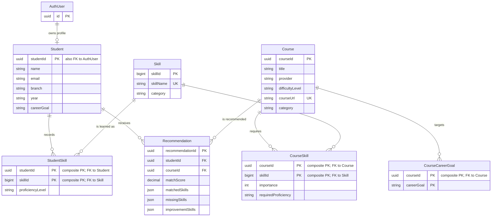

# Data Architecture & Persistence Layer

The persistence layer uses Supabase PostgreSQL with seven application relations plus Supabase Auth. SQL migrations define the schema, constraints, row-level policies, recommendation computation, and snapshot refresh; there is no ORM.

## Database Configuration

| Service/Module | DB Type | Profile | Driver | Connection | Migration Tool |
|---|---|---|---|---|---|
| SkillPath application | PostgreSQL on Supabase | Configured by the developer's Supabase project | Supabase JavaScript client over Supabase APIs | Project URL and publishable key in local/server environment | Ordered SQL migrations in `supabase/migrations` |

## Data Ownership per Service

| Service | Tables Owned | ORM Framework | Caching | Notes |
|---|---|---|---|---|
| Next.js SkillPath application | `students`, `skills`, `student_skills`, `courses`, `course_skills`, `course_career_goals`, `recommendations` | None; Supabase JavaScript client and PostgreSQL SQL | No explicit application cache | Authenticated operations are constrained by PostgreSQL RLS |
| Supabase Auth | `auth.users` | Supabase-managed | Supabase-managed; not configured in this repository | Student row references the auth user with a unique foreign key |

## Entity Model

<!-- mermaid-checked: every attribute is `<type> <name> [<key>] ["<description>"]` with at most one of PK/FK/UK, no \n in descriptions, no {} in descriptions, every relationship label is double-quoted -->

The `AuthUser` entity represents the Supabase-managed `auth.users` relation. Junction relations are shown explicitly because they carry proficiency, importance, and required-proficiency attributes.
The verified deployed student, skill, and student-skill definitions are `students(student_id, name, email, branch, year, career_goal, created_at)`, `skills(skill_id, skill_name, category)`, and `student_skills(student_id, skill_id, proficiency_level)`. Migration 004 defines the new relations. Repository migration 001 remains unchanged and describes a different historical shape; see `docs/dbms-design.md`.

## Key Repository Methods

| Service | Repository | Notable Methods | Purpose |
|---|---|---|---|
| Supabase client utilities | `lib/supabase/server.js`, `lib/supabase/client.js` | `createClient()` | Create cookie-aware server or browser clients |
| Recommendation database API | `supabase/migrations/004_courses_and_recommendations.sql` | `get_course_recommendations(UUID)`, `refresh_course_recommendations(UUID)` | Compute ranked recommendations; persist and remove stale snapshots |
| Profile and skill data access | `components/ProfileForm.js`, `components/SkillsManager.js` | Supabase `upsert`, `insert`, `update`, `delete` queries | Update the student's profile and proficiency-rated skills |
| Course catalog read | `app/(app)/courses/page.js` | Read `course_catalog` | Load courses and joined skill requirements |
| Saved recommendation read | `app/(app)/recommendations/page.js` | RPC refresh then select `recommendations` with related `courses` | Display persisted ranked results and skill gaps |

## Caching Strategy

No explicit Redis, in-memory, or query-result cache is configured in the repository. Supabase queries are request-time reads; recommendation results are persisted as database snapshots and recalculated by the refresh function and database triggers, rather than served from an application cache.

## Data Ownership Boundaries

The application uses one shared Supabase PostgreSQL database. The Next.js application reads and writes domain records through the Supabase API; Supabase Auth owns identity records. There is no service-to-service database boundary or CQRS implementation. PostgreSQL functions centralize recommendation scoring, while Next.js pages render catalog and saved results. RLS provides per-student access boundaries for profile-linked data and recommendation rows.

### Data Classification & Sensitivity

| Entity | Sensitive Fields | Classification (PII/PHI/PCI/None) | Controls in Place |
|---|---|---|---|
| `students` | `full_name`, `email`, `college`, `branch`, `academic_year`, `career_goal`, `bio` | PII | Student-row RLS policies scope access by `auth_user_id`; field-level masking is not configured. Supabase platform encryption-at-rest settings cannot be verified from repository files. |
| Supabase `auth.users` | Email and authentication records | PII | Supabase Auth-managed; project-level encryption and retention settings are not verifiable here. |
| `student_skills` | Student skill and proficiency history | Personal educational profile data | RLS policies scope rows through the owning student. |
| `skills`, `courses`, `course_skills`, `course_career_goals` | None identified | None | Catalog reads are available to authenticated users. |
| `recommendations` | Student-course match and skill-gap profile | Personal educational profile data | RLS allows a student to read only their own rows; direct client writes are revoked. |
